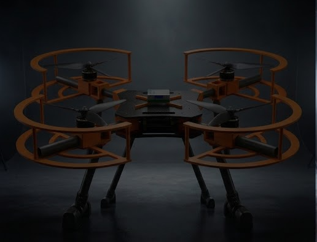
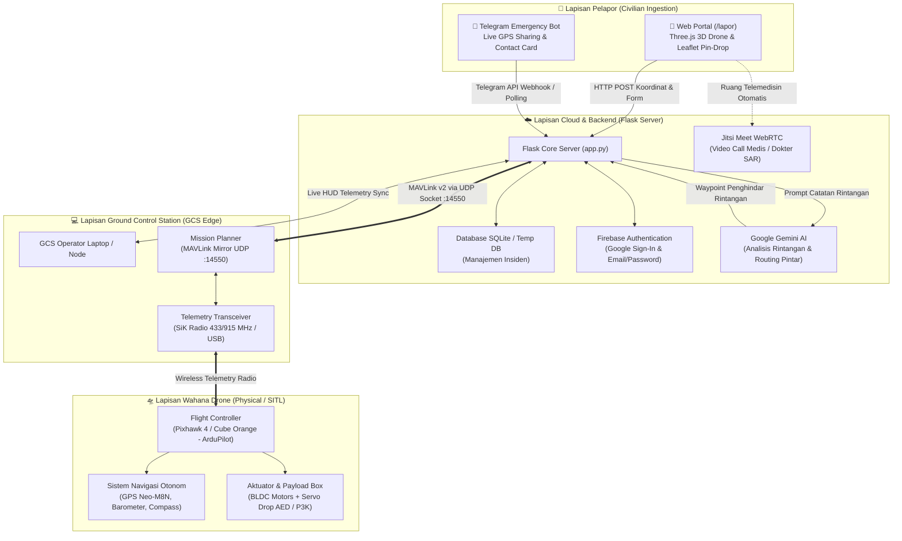
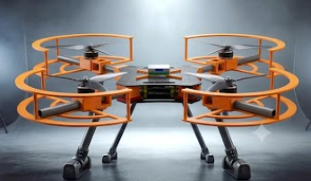
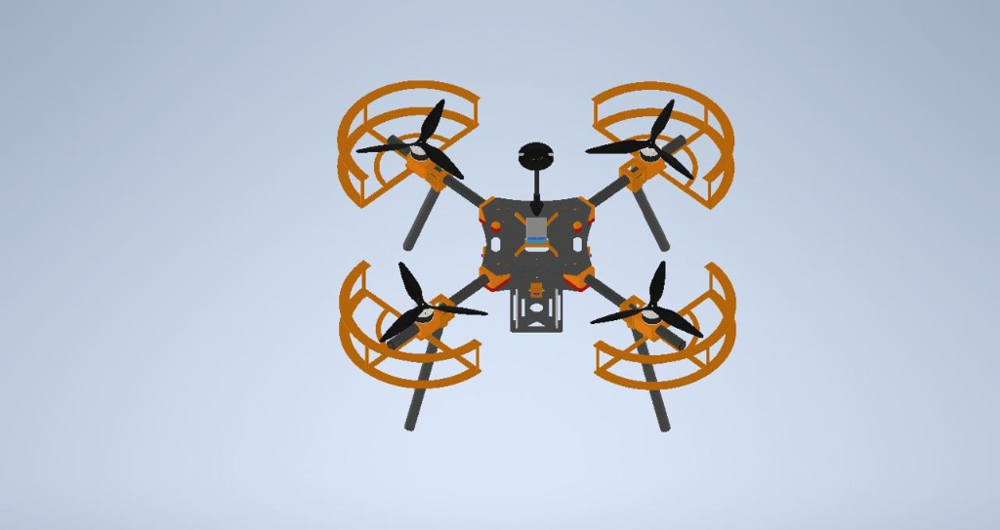
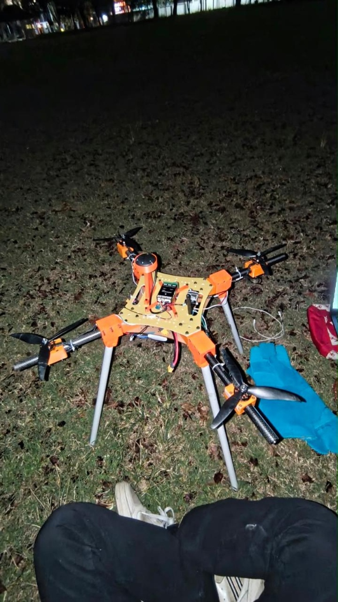
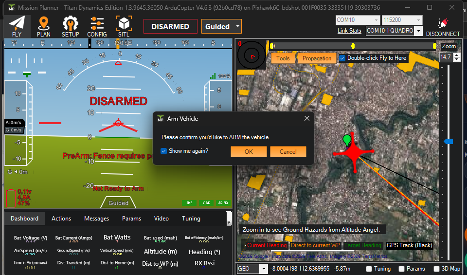

<div align="center">

# 🛸 RescueDrone (USAR)
### *Autonomous Aerial First-Response System with Web MAVLink Ground Control Station, 3D Digital Twin, and AI Flight Routing*

[](https://python.org)
[](https://flask.palletsprojects.com/)
[](https://threejs.org/)
[](https://mavlink.io/)
[](https://ardupilot.org/)
[](https://firebase.google.com/)
[](https://vercel.com/)
[](LICENSE)

<br/>



<br/><br/>

**Sistem tanggap darurat kecelakaan & medis otonom berbasis drone (UAV) yang mendahului kedatangan ambulans darat untuk pertolongan pertama (Golden Hour) di lokasi kejadian.**

[🌐 Demo Online (Vercel)](#-panduan-deploy-ke-vercel) • [📖 Fitur Utama](#-fitur-unggulan) • [📐 Arsitektur Sistem](#-arsitektur-sistem) • [🚀 Cara Menjalankan](#-panduan-instalasi--penggunaan) • [📡 API Reference](#-dokumentasi-rest-api)

---

</div>

## 📌 Daftar Isi
- [Latar Belakang & Urgensi](#-latar-belakang--urgensi)
- [Arsitektur Sistem](#-arsitektur-sistem)
- [Galeri & Antarmuka Aplikasi](#-galeri--antarmuka-aplikasi)
- [Fitur Unggulan](#-fitur-unggulan)
- [Spesifikasi Hardware & Avionik](#-spesifikasi-hardware--avionik)
- [Panduan Instalasi & Penggunaan](#-panduan-instalasi--penggunaan)
  - [Mode 1: Lokal (Drone Fisik / SITL ArduPilot)](#mode-1-lokal-drone-fisik--ardupilot-sitl)
  - [Mode 2: Deploy ke Vercel (Cloud Demo)](#mode-2-deploy-ke-vercel-cloud-demo)
  - [Mode 3: Integrasi Telegram Emergency Bot](#mode-3-integrasi-telegram-emergency-bot)
- [Dokumentasi REST API](#-dokumentasi-rest-api)
- [Struktur Direktori Proyek](#-struktur-direktori-proyek)
- [Tim & Penghargaan](#-tim--penghargaan)

---

## 💡 Latar Belakang & Urgensi

Di area perkotaan yang padat maupun daerah terpencil, ambulans darat sering kali terhambat kemacetan lalu lintas, jarak tempuh, atau akses jalan yang sempit. Pada kasus darurat seperti henti jantung mendadak (*Sudden Cardiac Arrest*), trauma berat, atau kecelakaan lalu lintas, **setiap menit keterlambatan menurunkan peluang bertahan hidup korban sebesar 7-10% (The Golden Hour)**.

**RescueDrone** hadir sebagai solusi pionir dengan menggabungkan:
1. **Kecepatan Udara UAV Otonom**: Mampu terbang garis lurus (*point-to-point*) membawa muatan darurat (AED / Kotak P3K Trauma).
2. **Platform Web MAVLink GCS**: Operator SAR dapat memantau telemetri nyata, meng-arm drone, mengunggah multi-waypoint, dan memicu fail-safe darurat langsung dari browser.
3. **Omnichannel Pelaporan Warga**: Memungkinkan saksi mata melapor via portal web interaktif (*pin-drop location*) atau Telegram Bot, langsung terhubung ke telemedisin dokter secara *real-time*.

---

## 📐 Arsitektur Sistem

RescueDrone dirancang dengan arsitektur terdistribusi *hybrid cloud-edge* yang andal:



---

## 🖼️ Galeri Visual & Desain Sistem

| Visualisasi Wahana | Deskripsi Teknis |
| :---: | :--- |
|  | **RescueDrone Tactical Edition**: Desain aerodinamis serat karbon berkecepatan tinggi dengan payload kit trauma darurat (AED / Kotak P3K). |
|  | **High-Visibility Emergency Edition**: Tampilan visual kontras tinggi untuk identifikasi lokasi dan pengamatan lapangan di segala kondisi cuaca. |
|  | **Model Mekanikal 3D CAD**: Struktur rangka quadcopter custom dengan arm tube serat karbon Ø16mm dan pelindung baling-baling keselamatan. |
|  | **Prototipe Fisik Uji Lapangan**: Integrasi nyata Flight Controller Pixhawk, modul telemetri radio, tiang kompas GPS, dan kaki pendarat tinggi. |
|  | **Sinkronisasi MAVLink GCS (Mission Planner)**: Telemetri nyata penerbangan dan konfirmasi eksekusi perintah ARM (`MAV_CMD_COMPONENT_ARM_DISARM`) pada Pixhawk 6C (ArduCopter V4.6.3). |

---

## 🖥️ Modul & Antarmuka Aplikasi

| Modul Antarmuka | Fungsi Utama | Jalur Akses |
| :--- | :--- | :---: |
| **Portal Publik & 3D Digital Twin** | Visualisasi 3D drone interaktif Three.js WebGL dengan animasi baling-baling berputar dan pencahayaan studio responsif. | `/lapor` |
| **Maxim/Uber-Style Location Picker** | Penentuan titik insiden instan dengan pin tengah presisi, auto-reverse geocoding, dan deteksi GPS saksi mata. | `/lapor` (Form) |
| **Tactical GCS HUD & Live Telemetry** | Indikator instrumen penerbangan MAVLink nyata (ketinggian relatif, kecepatan udara, watt baterai, satelit GPS, heading). | `/admin` |
| **Sinkronisasi Waypoint MAVLink** | Injeksi rute misi dari web yang langsung ter-upload dan terbaca secara *real-time* di Mission Planner. | `/admin` |
| **Telegram Emergency Bot** | Jalur cepat pelaporan masyarakat melalui tombol share lokasi otomatis dan kartu kontak WhatsApp. | `@RescueDroneBot` |
| **Military-Grade Glassmorphic Login** | Portal otentikasi aman terintegrasi dengan Firebase Google OAuth dan akun email SAR. | `/admin/login` |

---

## ⭐ Fitur Unggulan

### 1. 🕹️ Kendali MAVLink Otonom & Auto-Arming
- Mengimplementasikan protokol resmi **MAVLink v2 (`COMMAND_LONG`)**:
  - **Auto Arm / Disarm**: Mengirimkan perintah `MAV_CMD_COMPONENT_ARM_DISARM` (ID: 400) dilengkapi *popup konfirmasi keamanan berlapis*.
  - **Otonom Takeoff**: Perintah `MAV_CMD_NAV_TAKEOFF` (ID: 22) ke ketinggian aman yang ditentukan.
  - **Fail-Safe RTL**: Tombol darurat *Return to Launch* (`MAV_CMD_NAV_RETURN_TO_LAUNCH`) untuk memanggil drone kembali ke titik awal secara instan.
- Arsitektur koneksi cerdas: Mampu membaca port serial `COM` fisik sekaligus *mirroring* ke jalur `udp:127.0.0.1:14550` tanpa bentrok dengan Mission Planner.

### 2. 🧠 AI-Powered Flight Routing (Google Gemini API)
- Backend dilengkapi modul analisis NLP menggunakan **Google Gemini API** yang mampu mengekstrak informasi rintangan fisik dari deskripsi saksi mata (contoh: *"ada pohon 15m dan tiang listrik di jarak 1km"*).
- Sistem otomatis menghitung ketinggian jelajah (*transit altitude*) dan menyisipkan *spatial avoidance waypoints* agar drone tidak menabrak rintangan saat menuju lokasi korban.

### 3. 🛸 3D Digital Twin Hexacopter (Three.js)
- Model 3D drone prosedural berbasis WebGL yang ringan tanpa perlu aset 3D eksternal yang berat.
- Dilengkapi material serat karbon (*carbon-fiber*), pelindung propelan oranye, lampu status, dan animasi rotasi baling-baling counter-rotating yang responsif di segala ukuran layar perangkat.

### 4. 📍 Geolocation Dispatching ala Maxim/Uber
- Antarmuka peta berbasis **Leaflet & CartoDB Voyager Tiles**.
- Fitur *drag-to-pin* interaktif di mana pengguna cukup menggeser peta; alamat dan koordinat GPS (latitude & longitude) otomatis diperbarui via *reverse-geocoding*.

### 5. 🤖 Omnichannel Telegram Emergency Bot
- Warga cukup membuka bot Telegram dan menekan tombol **`📍 Kirim Lokasi Darurat (GPS)`**.
- Laporan langsung masuk ke database pusat tanpa perlu instalasi aplikasi tambahan.
- Mendukung fitur update nomor telepon WhatsApp dari kartu kontak pelapor tanpa membuat duplikasi tiket laporan.

### 6. 🩺 Telemedicine Video Call (Jitsi Meet WebRTC)
- Setiap tiket insiden yang dibuat secara otomatis menghasilkan ruangan video call terenkripsi (`https://meet.jit.si/rescuedrone-<id>`).
- Saksi mata di lokasi kejadian dapat langsung bertatap muka dengan dokter SAR untuk dipandu melakukan tindakan pertolongan pertama (seperti CPR atau pemasangan pad AED) sebelum drone mendarat.

### 7. 🔐 Firebase Cloud Authentication
- Perlindungan portal admin SAR menggunakan **Firebase Authentication** (Project: `rescue-tag-cc562`).
- Mendukung sistem **Google One-Click Sign-In** dan Email/Password dengan session token synchronization di Flask backend.

---

## 🛠️ Desain 3D CAD & Realisasi Prototipe Fisik

Proyek ini tidak hanya berfokus pada perangkat lunak, tetapi juga mencakup perancangan struktur mekanikal rangka dan integrasi avionik fisik secara menyeluruh:

| 📐 Desain 3D CAD (Digital Twin) | 🛸 Realisasi Prototipe Fisik (Field Test) |
| :---: | :---: |
|  |  |
| **Model CAD**: Rangka kustom dengan arm tube serat karbon, pelindung baling-baling oranye, dudukan antena GPS elevated, dan kompartemen avionik. | **Prototipe Nyata**: Wahana uji lapangan dengan *landing gear* tinggi, Flight Controller Pixhawk terintegrasi, dan komponen kustom *3D-printed*. |

---

## ⚙️ Spesifikasi Hardware & Avionik

| Komponen | Spesifikasi / Konfigurasi Nyata |
| :--- | :--- |
| **Airframe** | Custom Carbon Fiber Quadcopter (Tube Ø16mm) + 3D Printed Brackets |
| **Flight Controller** | Holybro Pixhawk 6C (bdshot) |
| **Firmware** | ArduCopter V4.6.3 Autopilot |
| **GCS Telemetry Software** | Mission Planner (Titan Dynamics Edition) |
| **Sistem Navigasi** | Eksternal GPS Compass Tower Neo-M8N + Barometer internal |
| **Propulsi** | Brushless Motors + Tri-Blade (3-Bilah) High-Efficiency Propellers |
| **Safety Features** | Pelindung Baling-baling (*Propeller Guards*) oranye visibilitas tinggi |
| **Landing Gear** | Tall High-Clearance Struts (Melindungi kompartemen payload bawah) |
| **Telemetry Link** | Holybro SiK Telemetry Radio COM10 (115200 Baud) & MAVLink UDP :14550 |
| **Payload Box** | Kompartemen pelepasan cepat (*Quick-Release*) muatan darurat (AED / P3K) |

---

## 🚀 Panduan Instalasi & Penggunaan

### Mode 1: Lokal (Drone Fisik / ArduPilot SITL)

1. **Clone Repositori**:
   ```bash
   git clone https://github.com/raihanbaskara/rescuedrone-web.git
   cd rescuedrone-web
   ```

2. **Buat & Aktifkan Virtual Environment**:
   ```bash
   python -m venv venv
   # Di Windows:
   venv\Scripts\activate
   # Di Linux/macOS:
   source venv/bin/activate
   ```

3. **Install Dependensi**:
   ```bash
   pip install -r requirements.txt
   ```

4. **Konfigurasi Variabel Lingkungan (Opsional)**:
   ```bash
   # Di Windows PowerShell:
   $env:FC_CONNECTION="udp:127.0.0.1:14550"   # atau COM10 jika terhubung kabel USB
   $env:DEFAULT_ALTITUDE_M="20"
   $env:TAKEOFF_ALTITUDE_M="50"
   ```

5. **Jalankan Simulator ArduPilot SITL (Jika tidak ada drone fisik)**:
   ```bash
   sim_vehicle.py -v ArduCopter --console --map -out udp:127.0.0.1:14550
   ```

6. **Jalankan Server RescueDrone**:
   ```bash
   python app.py
   ```
   Buka di browser:
   - Portal Lapor Warga: `http://localhost:5000/lapor`
   - Dashboard Admin SAR: `http://localhost:5000/admin` (Default: `admin` / `rescuedrone`)

---

### Mode 2: Deploy ke Vercel (Cloud Demo)

Proyek ini telah dikonfigurasi secara modular (`vercel.json` dan `api/index.py`) sehingga dapat di-deploy langsung ke **Vercel** untuk keperluan portofolio, pameran, maupun demo daring.

1. **Push kode terbaru ke GitHub**:
   ```bash
   git add .
   git commit -m "feat: configure Vercel serverless deployment and update documentation"
   git push origin main
   ```

2. **Hubungkan ke Vercel**:
   - Buka [Vercel Dashboard](https://vercel.com/dashboard) dan klik **"Add New" ➔ "Project"**.
   - Pilih repositori `rescuedrone-web`.
   - Vercel akan secara otomatis mendeteksi konfigurasi `vercel.json` dan runtime Python.

3. **Konfigurasi Environment Variables di Vercel (Settings ➔ Environment Variables)**:
   | Variable | Value Rekomendasi | Keterangan |
   | :--- | :--- | :--- |
   | `SECRET_KEY` | *(acak/rahasia)* | Kunci sesi Flask |
   | `GEMINI_API_KEY` | *(kunci Gemini AI)* | Opsional: Untuk fitur analisis rintangan AI |
   | `ADMIN_USERNAME` | `admin` | Username login admin |
   | `ADMIN_PASSWORD` | *(password admin)* | Password login admin |

4. **Klik "Deploy"**:
   - Dalam ~1 menit, aplikasi RescueDrone kamu akan aktif di URL `https://rescuedrone-web.vercel.app`.
   - *Catatan: Pada mode Vercel, sistem otomatis beralih ke **Cloud Simulation Mode**, di mana telemetri HUD beranimasi realistis dan seluruh fitur pelaporan, Firebase Auth, serta visual 3D dapat diuji tanpa perlu menghubungkan flight controller fisik!*

---

### Mode 3: Integrasi Telegram Emergency Bot

1. Dapatkan token bot dari [@BotFather](https://t.me/BotFather) di Telegram.
2. Pasang token sebagai Environment Variable:
   ```bash
   $env:TELEGRAM_BOT_TOKEN="YOUR_BOT_TOKEN_HERE"
   ```
3. Saat server Flask berjalan secara lokal, thread bot akan otomatis melakukan *polling*. Saat saksi mata menekan `/start`, bot akan langsung menyajikan tombol darurat.

---

## 📡 Dokumentasi REST API

| Method | Endpoint | Deskripsi | Payload / Parameter |
| :---: | :--- | :--- | :--- |
| `GET` | `/lapor` | Halaman publik pelaporan darurat (3D Model + Peta). | - |
| `GET` | `/admin` | Dashboard operasional Admin SAR & Tactical HUD. | Session `is_admin` |
| `POST` | `/api/reports` | Membuat laporan kecelakaan / insiden baru. | `FormData`: `lat`, `lng`, `reporter_name`, `whatsapp_contact`, `video` |
| `GET` | `/api/incidents` | Mengambil seluruh daftar insiden darurat aktif. | Query: `status` (opsional) |
| `PUT` | `/api/incidents/<id>` | Memperbarui status / informasi penanganan insiden. | `JSON`: `status`, `patient_notes`, dll. |
| `POST` | `/api/upload-mission` | Meng-upload waypoint navigasi ke Flight Controller. | `JSON`: `lat`, `lon`, `alt_m`, `incident_id` |
| `POST` | `/api/arm-takeoff` | Meng-arm drone (`ID: 400`) & memicu auto-takeoff. | `JSON`: `{ "action": "arm_and_takeoff" }` |
| `POST` | `/api/rtl` | Memerintahkan drone segera kembali ke Home (RTL). | `JSON`: `{ "action": "rtl" }` |
| `GET` | `/api/telemetry` | Mengambil status telemetri nyata (speed, alt, bat, GPS). | - |
| `POST` | `/api/firebase-login` | Sinkronisasi otentikasi Firebase (Google / Email). | `JSON`: `uid`, `email`, `displayName` |

---

## 📂 Struktur Direktori Proyek

```
rescuedrone-web/
├── api/
│   └── index.py               # WSGI Entry point untuk serverless runtime Vercel
├── docs/
│   └── screenshots/           # Aset gambar tangkapan layar untuk portofolio GitHub
│       ├── hero_3d_drone.png
│       ├── reporter_map.png
│       ├── admin_dashboard.png
│       ├── mission_planner_sync.png
│       └── telegram_bot_flow.png
├── static/                    # Aset statis (CSS, JavaScript, Audio, Icons)
├── templates/
│   ├── index.html             # Dashboard Admin SAR (Tactical HUD, Waypoint Upload, MAVLink)
│   ├── user.html              # Halaman Pelapor (Hero 3D Drone Three.js + Maxim Light Map)
│   ├── admin_login.html       # Portal Login Glassmorphic (Firebase Auth & Google Sign-In)
│   └── admin.html             # Halaman manajemen rekap panggilan
├── uploads/                   # Direktori penyimpanan bukti video insiden dari saksi
├── app.py                     # Inti Backend Flask: MAVLink Telemetry, AI Engine, & API Routes
├── telegram_bot.py            # Modul Listener & Dispatcher Telegram Emergency Bot
├── rescuedrone.db             # Basis data SQLite lokal untuk insiden
├── requirements.txt           # Dependensi pustaka Python
├── vercel.json                # Konfigurasi deployment Vercel Serverless
├── .vercelignore              # Berkas yang diabaikan saat deploy ke Vercel
└── README.md                  # Dokumentasi komprehensif proyek
```

---

## 👥 Tim & Penghargaan

Proyek inovasi teknologi ini dikembangkan dalam rangka:
- **Program Riset & Inovasi Teknologi Robotika / Kebencanaan (ERIC)**
- **Universitas Negeri Malang (UM)**
- **Lead Developers & System Architects**:
  - **Raihan Nauval Aziz**
  - **Muhammad Rafi Baihaqi**

---

<div align="center">

*Dikembangkan dengan dedikasi untuk mempercepat pertolongan pertama dan menyelamatkan lebih banyak nyawa.*

⭐ **Jangan lupa beri bintang (*Star*) pada repositori ini jika kamu merasa proyek ini bermanfaat!**

</div>
